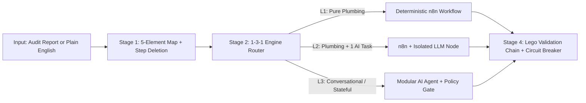

# `/automate` — AIOS Automation Architect Skill (n8n + AI Agents)

[](https://portfolio-msl.lovable.app/)
[](https://auditiq.ai.studio)
[](#quick-install)
[](./LICENSE)

**Stop prompting AI to generate giant, broken n8n JSONs or over-engineered autonomous agents when a 5-node deterministic workflow solves the problem.**

`/automate` is a permanent AI Operating System (AIOS) skill engineered by **MSL AI Systems** (`https://portfolio-msl.lovable.app/`). It turns any business bottleneck, operational audit report, or plain-English automation idea into a verified **n8n workflow** or **stateful AI agent** using a strict 4-stage engineering pipeline.

---

## Why Most AI Automations Fail (And How `/automate` Fixes It)

Most builders jump straight to an autonomous multi-agent loop (Autonomy Level 4) without questioning the steps first. The result is brittle workflows, hallucinated JSON expressions, and silent production failures.

`/automate` enforces a 4-stage engineering protocol grounded in **The Three Ms of AI™ (Mindset, Method, Machine)**, **First-Principles Step Deletion**, and the **1-3-1 Engine Router**:



---

## The 4-Stage `/automate` Pipeline

### Stage 1: 5-Element Process Map & Step Deletion Gate
Before writing a single n8n node or line of Python/TypeScript, `/automate` maps:
1. **Trigger:** What kicks it off (Webhook, Cron, Payment, Form, Chat ingress).
2. **Data Sources:** Where context lives (CRM, Google Sheets, SQLite, Knowledge JSON).
3. **Data Transformations:** E.164 phone sanitization, email normalization, deduplication.
4. **Decision Points:** Deterministic `IF/Switch` rules vs. confidence-scored AI classification.
5. **Destination:** CRM upsert, WhatsApp/Slack dispatch, Google Drive provisioning.

**The Deletion Rule:** The skill forces the agent to identify and **delete at least 1 redundant step or approval** before automating what remains, applying the **60/30/10 Golden Rule** (~60% fully automated, ~30% AI-assisted, ~10% human edge-case review).

### Stage 2: The 1-3-1 Engine Router (n8n vs. AI Agent)
For every automation request, `/automate` presents **1 Problem, 3 Viable Options, and 1 Recommendation** defaulting to the lowest Autonomy Level that works (*"Boring is Beautiful"*):

| Option | Autonomy | Architecture | Best For |
| :--- | :---: | :--- | :--- |
| **Option 1: Pure n8n** | **L1 / L2** | 100% deterministic n8n nodes (Webhook -> Sanitizer -> IF/Switch -> CRM/WhatsApp). Zero LLM calls. | Lead routing, onboarding folder setup, scheduled KPI digests. |
| **Option 2: n8n + Isolated AI Node** | **L2 / L3** | 85% deterministic n8n plumbing + **1 isolated LLM node** (`temperature: 0.1`, strict JSON schema) for scoring or extraction. | Qualifying messy form notes, summarizing ad metrics, drafting replies. |
| **Option 3: Stateful AI Agent** | **L3** | Modular Python/TS agent with a **Deterministic Policy Gate first**, grounded FAQ/RAG, SQLite state, and human approval fallback. | Multi-turn Telegram/WhatsApp bots, gated community admission, support triage. |

### Stage 3: Lego Assembly & Safety Brakes
Instead of hallucinating untested schemas from scratch, `/automate` stamps out modular blocks with mandatory production guardrails baked in:
- **E.164 Phone & Email Sanitization** on every ingress webhook.
- **Error Circuit Breaker:** An `Error Trigger` route that alerts your WhatsApp or Slack immediately if an API fails.
- **Deterministic Policy Precedence (for Agents):** Hardcoded business rules (payment verification, eligibility thresholds) always execute *before* any LLM prompt, and raw customer PII is never leaked to third-party prompts.

### Stage 4: Lego Validation Chain & 14-Day Bike Method Rollout
Every `/automate` output includes a block-by-block validation checklist (test Block 1 with a real payload before connecting Block 2), a **14-day Supervised Rollout plan**, and a **10-second Kill Switch**.

---

## Quick Install

`/automate` works out of the box with **Claude Code**, **OpenAI Codex**, and **Google Antigravity**.

### 1. Clone the repository
```bash
git clone https://github.com/Ibnalkabeer/msl-automate-skill.git
```

### 2. Copy into your AIOS workspace
**For Claude Code (`.claude/skills/`):**
```bash
mkdir -p .claude/skills/automate
cp msl-automate-skill/SKILL.md .claude/skills/automate/SKILL.md
cp -r msl-automate-skill/templates .claude/skills/automate/
```

**For OpenAI Codex & Google Antigravity (`.agents/skills/`):**
```bash
mkdir -p .agents/skills/automate
cp msl-automate-skill/SKILL.md .agents/skills/automate/SKILL.md
cp -r msl-automate-skill/templates .agents/skills/automate/
```

---

## How to Use

Trigger `/automate` in your AI coding assistant using any of the 3 input modes:

1. **Drop an Operational Audit Report (e.g., AuditIQ):**
   ```text
   /automate [paste or attach your AuditIQ diagnostic report]
   ```
2. **Describe a Workflow in Plain English:**
   ```text
   /automate Take incoming Meta Lead Ads, normalize Nigerian & international phone numbers to E.164, score urgency with AI, log to Google Sheets, and send an instant WhatsApp alert to the sales rep.
   ```
3. **Ask for an n8n vs. AI Agent Architecture Verdict:**
   ```text
   /automate Should I build our customer onboarding verifier in n8n or as a Python Telegram agent?
   ```

See [`examples/sample-audit-to-automation.md`](./examples/sample-audit-to-automation.md) for a complete end-to-end output example, and [`templates/starter-speed-to-lead.n8n.json`](./templates/starter-speed-to-lead.n8n.json) for the bundled starter n8n workflow.

---

## Need Production AI Automations Built in 48 Hours?

This open-source skill is maintained by **MSL AI Systems** — a B2B technology and AI automation company building modern websites, custom AI agents, and production n8n infrastructure for growing businesses and digital agencies.

- **Run a Free 4-Step AI Readiness Diagnostic (AuditIQ):** [https://auditiq.ai.studio](https://auditiq.ai.studio)
- **Explore MSL AI Systems Portfolio:** [https://portfolio-msl.lovable.app/](https://portfolio-msl.lovable.app/)
- **Book a 15-Minute Automation Sprint Consult on WhatsApp:** [Chat with MSL AI Systems on WhatsApp](https://wa.me/2347079731073?text=Hi%20MSL%20AI%20Systems%2C%20I%20saw%20your%20%2Fautomate%20GitHub%20repo%20and%20want%20to%20discuss%20an%20automation%20sprint.)
- **Email:** [muhsinalonigbeja@gmail.com](mailto:muhsinalonigbeja@gmail.com)

---

## Credits & Attribution

- **Engineered by:** Muhsin Alonigbeja — Founder, [MSL AI Systems](https://portfolio-msl.lovable.app/)
- **Methodology Inspiration:** *The Three Ms of AI™ (Mindset, Method, Machine)* is a trademark of Nate Herk (© 2026 Nate Herk).
- **License:** [MIT License](./LICENSE)
